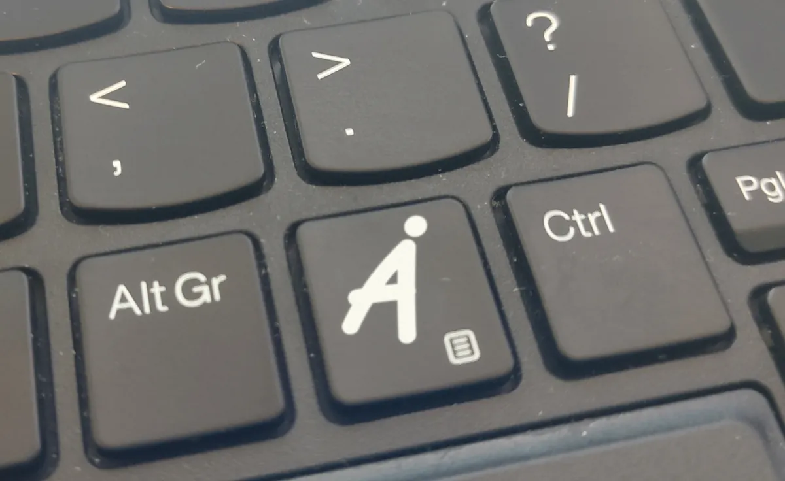

# local-llm-hotkeys

[](https://github.com/annejan/local-llm-hotkeys/actions/workflows/ci.yml)

**Your laptop has an AI key? Make it do something, on your own NPU.** ([annejan.com/ai-key](https://annejan.com/ai-key/))

Many new laptops have a Copilot key. On Linux it does nothing. This project gives it four
jobs, and runs all of them on the AMD Ryzen AI NPU that is already in the laptop. There is no
cloud, no account and no subscription. Nothing leaves your computer, it works offline, and the
GPU stays free.



| Press | You get |
|---|---|
| **Copilot** | a chat window. Ask anything, then ask follow-up questions. |
| **Alt+Copilot** | the copied text, translated to your language. Then ask about it. |
| **Ctrl+Copilot** | the copied text explained in a few plain sentences, in your language, with a to-do list if it asks you to do something. Then ask about it. |
| **Ctrl+Alt+Copilot** | the window in front of you explained: "what is this error, and what do I do?" |

Some examples:

- A letter from the tax office that you do not understand: copy it, press Ctrl+Copilot,
  and read what it says and what you must do before which date.
- A Ukrainian news article, a German invoice, a Japanese error message: copy it and press
  Alt+Copilot.
- An error dialog, a settings page, a chart: press Ctrl+Alt+Copilot, then ask "and how do I
  fix that?"

"Your language" is the language of your desktop, or the one you set (`HOTKEYS_LANGUAGE`). No AI
key? Every action also has a Meta+Shift shortcut.

## Hotkeys

| Key | Action |
|---|---|
| Copilot or Meta+Shift+Q | chat (`aikey --popup`) |
| Alt+Copilot or Meta+Shift+T | translate the clipboard to your language (`uktr clip`) |
| Ctrl+Copilot or Meta+Shift+E | explain the clipboard (`eli12 clip`) |
| Ctrl+Alt+Copilot or Meta+Shift+W | explain the active window (`aikey --screen`) |
| Meta+Shift+X | explain a screen region that you select (`aikey --region`) |
| Meta+Shift+Y | translate a screen region (`uktr shot`) |
| Meta+Shift+F | fix spelling and grammar of the clipboard (`fixtext clip`) |
| Meta+Shift+D | dictate: speak, and the text is typed into the active window (`dictate`) |
| Meta+Ctrl+Shift+D | dictate and translate: speak your language, English is typed (`dictate --translate`) |

In Dolphin, right-click a document for "Translate (uktr)" and "Explain like I'm 12 (eli12)".
AltGr works as Alt. See [Install](#install) for the setup and [the Copilot key](#the-copilot-key).

### The tools

- **uktr**: rough translation of Ukrainian (or any other language) to your language: the
  clipboard, a screen region, documents, or live subtitles for audio.
- **eli12**: explains a text like you are 12.
- **fixtext**: fixes spelling and grammar of the clipboard.
- **aikey**: a chat window for quick questions and follow-ups, also about a screenshot.
- **dictate**: speak, and the text is typed into the active window.

All of them talk to any OpenAI-compatible server. The default setup runs everything on the NPU
with [FastFlowLM](https://fastflowlm.com/); ollama on a GPU also works.
Python standard library only, except the `aikey` chat window, which uses PySide6.

## uktr: translate

Rough translation with a local LLM. It is for reading, not for publishing. The output is
rough, and some mistakes are funny.

| Command | Input | Output |
|---|---|---|
| `uktr` | stdin | stdout |
| `uktr clip` | clipboard | chat window, result also copied to the clipboard |
| `uktr shot` | screen region (spectacle + tesseract OCR) | chat window |
| `uktr FILE [-o OUT]` | `.pdf` `.epub` `.docx` `.odt` `.html` `.txt` `.md` | `FILE.nl.md` (your language) |
| `uktr --notify FILE` | same, with notifications (Dolphin menu) | `FILE.nl.md` |
| `uktr listen [--orig]` | system audio (live) | subtitles in the terminal |

The target language is your language (`HOTKEYS_LANGUAGE`, else the desktop's). Set `UKTR_TO` to
translate to another one. The output file gets the language code: `FILE.nl.md` for Dutch,
`FILE.en.md` for English. Long text goes to the model in chunks of about 1500 characters,
split at paragraph breaks.

From the hotkeys, the translation opens in the `aikey` chat window: it appears while the model
writes it (the first words after about 2 s), part after part for a long text, and Esc stops
it. The text shows exactly as it was written, line for line. When it is complete, it is also
on the clipboard. Then ask about it ("what does this word mean?", "is this formal?"): those
questions go to the chat model (`AIKEY_MODEL`), because a translation model cannot chat; the
first one takes a few seconds more while FastFlowLM switches models. The chat is saved with
the other `aikey` chats (with a 🌐 title). Without PySide6, or with `UKTR_WINDOW=0`, the
translation shows in a plain text box instead.

### `uktr listen`

Live subtitles for what plays on the speakers (YouTube, a call, a podcast):

1. `parec` records the default sink monitor at 16 kHz mono.
2. Audio is cut into chunks of 4–12 s. The cut goes at the quietest 0.25 s, so words
   are not split. Silent chunks are dropped (Whisper invents "Thank you." on silence).
3. Whisper transcribes each chunk (`/v1/audio/transcriptions`).
4. The translation model translates the text.

`--orig` also shows the transcription, dimmed. Lines appear about 12 s after the speech.
On the NPU, 30 s of audio takes about 7 s to transcribe and translate.

The spoken language is set with `UKTR_LANG` (default `uk`). Whisper language detection
is unreliable on short chunks, so set it.

```sh
konsole -e uktr listen --orig
```

## eli12: explain it like I'm 12

`eli12` reads a text (a long boring email, a README, an article, a PDF) and says in at most
5 short sentences what it is about and what matters most, in plain words.

If the text asks you to do something, as an email or letter does, `eli12` ends with a line
`Te doen:` (`To do:` in English) that lists every action with its deadline. Dates are copied
as written. For documentation such as a README there is no such line: the model first labels
the text as a message or a document, and the code drops everything after the explanation for a
document.

| Command | Input | Output |
|---|---|---|
| `eli12 FILE` | same file types as uktr | stdout |
| `eli12 < text` | stdin | stdout |
| `eli12 clip` | clipboard | chat window |
| `eli12 --popup FILE` | file | chat window (Dolphin menu) |

It writes in your language. `-l LANG` picks another one (`-l en`, `-l German`), and `-l both`
gives your language followed by English.

From the hotkey or Dolphin, the explanation opens in the `aikey` chat window: it appears while
the model writes it (the first words after about 2 s), Esc stops it, and you can ask about the
text: "what happens if I pay late?" The answers to those questions come only from the text;
if the text does not say it, the answer says so. The chat is saved with the other `aikey` chats
(with a 💡 title). Without PySide6, with `-l both`, or with `ELI12_WINDOW=0`, the explanation
shows in a plain text box instead.

It uses a chat model (`ELI12_MODEL`, default `qwen3.5:9b`), because translation models cannot
explain. A long README (about 2000 words) takes about 25 s on the NPU. Text after the first
60,000 characters is ignored.

Example (a long email from a facility team about a new booking system and lockers):

> Het facilitair team introduceert een nieuw reserveringssysteem en vervangt kluisjes. Je moet
> je oude boekingen opnieuw maken en persoonlijke spullen uit de kasten halen.
>
> Te doen: […] terugkerende werkplekreserveringen in FlexDesk 4 uiterlijk vrijdag 12 december
> […]; persoonlijke eigendommen uit kluisjes op de tweede verdieping vóór maandag 8 december.

For an email in Thunderbird: select the text, press Ctrl+C, then Meta+Shift+E.

The model reads all of the text, also parts that you do not see, such as white text in an
email. A text that is written to trick the model can make the explanation wrong, for example
"no action needed". For a letter that matters, read the parts about money and dates yourself.

## fixtext: fix spelling and grammar

Copy a text, press Meta+Shift+F, and paste. `fixtext` fixes spelling, grammar, punctuation
and capitalization in any language. It does not translate or rephrase, and keeps line breaks,
names, URLs and code.

| Command | Input | Output |
|---|---|---|
| `fixtext clip` | clipboard | clipboard |
| `fixtext < text` | stdin | stdout |
| `fixtext FILE` | same file types as uktr | stdout |

With `clip` you get two notifications: "fixing N words…" at the start, and at the end the
changes (`wich → which`, `tomorow? → tomorrow?`) with the fixed text on the clipboard. If
there are no mistakes, the clipboard stays as it was. A short paragraph takes 3–6 s on the
NPU.

The model sometimes answers a question in the text, or carries out an instruction in it
("translate this"), instead of fixing it. If a fixed part is much shorter or longer than the
original, or more than half of its words changed, `fixtext` keeps the original part and says
so in the notification. Model:
`FIX_MODEL`, default `qwen3.5:9b`. Text over 20,000 characters is refused.

## aikey: chat

Meta+Shift+Q (or the Copilot key) opens a chat window. Type a question and press Enter; the
answer streams in as the model writes it, with markdown (code blocks, lists). Ask follow-up
questions: the model sees the whole conversation. It answers in the language of your message
and knows today's date, the distribution and the desktop (for example "openSUSE Tumbleweed,
KDE Plasma 6.8 on Wayland"), so commands fit your system.

| Key | Action |
|---|---|
| Enter / Shift+Enter | send / new line |
| Esc | stop the answer, or close the window |
| Ctrl+N | new chat |
| Ctrl+H | show or hide the saved chats |
| Ctrl+Shift+C | copy the last answer |
| Ctrl+V on an image | ask about the image (also: drag it to the question box) |

| Command | Input | Output |
|---|---|---|
| `aikey --popup` | chat window | chat window |
| `aikey --screen` | screenshot of the active window | chat window |
| `aikey --region` | screenshot of a region that you select | chat window |
| `aikey` | chat in the terminal (`/new` starts a new chat, Ctrl+D or `/quit` quits) | terminal |
| `aikey --list` | saved chats, newest first | stdout |
| `aikey --resume [N]` | continue saved chat N (default 1, the newest) | terminal |
| `aikey QUESTION...` | command line | stdout |
| `aikey < question` | stdin | stdout |

Model: `AIKEY_MODEL`, default `qwen3.5:9b`. The first words come after about 1 s. When a
conversation gets longer than about 24,000 characters, the oldest messages are dropped. A 9B
model makes mistakes, so check facts that matter.

To choose the model per chat, list the ones you want in `AIKEY_MODELS`, for example
`AIKEY_MODELS=qwen3.5:9b,gemma4-it:e4b,gpt-oss:20b`. With two or more, the window gets a menu
next to New chat; in the terminal, type `/model NAME`. The chat keeps its model when you open
it again. FastFlowLM loads one model at a time, so the first answer after a switch takes a few
seconds more. The list is yours to choose: the server also lists models that are not
downloaded, and does not say which ones read images (needed for screenshots). In a test with
instructions hidden in texts (`tests/injection.py`), the small vision models followed them far
more often than `qwen3.5:9b` and `gemma4-it:e4b`.

### Explain the active window or a region

Ctrl+Alt+Copilot or Meta+Shift+W (`aikey --screen`) takes a screenshot of the active window and
opens the chat with it. The model says what is on the screen, and explains an error, a question or a choice
if there is one. Then ask follow-up questions about it ("what does this setting do?").

For one error message in a big window, press Meta+Shift+X (`aikey --region`) instead and drag a
rectangle around it. Press Esc to cancel.

`qwen3.5:9b` reads images, so this is the same model as the chat: about 8 s for the first
answer on the NPU. The screenshot is scaled to 1280 pixels and saved with the chat. Set
`AIKEY_SCREEN_PROMPT` to change the first question. The answer is in your language.

### Paste or drop an image

Paste an image in the question box (Ctrl+V), or drag it there: a picture copied in Spectacle
or a browser, or image files copied or dragged from Dolphin. It shows as a thumbnail above the
box and goes with your next question; Remove takes it off. Without a question, the model gets
the screenshot question. Up to 4 images per question, scaled to 1280 pixels and saved with the
chat. Other files paste as their path, as before. The model of the chat must read images:
`qwen3.5:9b` and `gemma4-it:e4b` do, `gpt-oss:20b` does not.

A web page in the screenshot can tell the model to write a link that sends your chat to
someone else. So a link in an answer opens only after the window shows you the full address
and you click Yes.

### Saved chats

Every chat from the window or the terminal is saved after each answer, as a JSON file in
`~/.local/share/local-llm-hotkeys/chats/`. The window shows them on the left, newest first:
click one to read it and ask more. Right-click or Del removes a chat (after a confirmation).
One-shot questions (`aikey QUESTION`, `aikey < question`) are not saved. Set `AIKEY_HISTORY=0`
to save nothing.

## dictate: speak instead of type

Press Meta+Shift+D and speak. When you stop talking for 2 seconds (or press Meta+Shift+D
again), Whisper on the NPU writes down what you said, and the text is typed into the window
that has the focus: a chat, an email, a terminal.

| Command | Input | Output |
|---|---|---|
| `dictate` | microphone | typed into the active window |
| `dictate --print` | microphone | stdout |
| `dictate --translate` | microphone | translated, typed into the active window (Meta+Ctrl+Shift+D) |

You speak your language (`DICTATE_LANG`, default `HOTKEYS_LANGUAGE`). The text is typed by
pasting: it goes on the clipboard and the primary selection, and a virtual keyboard presses
Shift+Insert, which pastes in Qt and GTK apps, browsers and Konsole. The virtual keyboard
needs write access to `/dev/uinput` (check with `test -w /dev/uinput && echo ok`). Without
it, dictate does not type: the text stays on the clipboard, a notification shows it, and you
press Ctrl+V. See [Requirements](#requirements) for where the access comes from, and what it
allows.

With `--translate` (Meta+Ctrl+Shift+D) you speak your language and the text is typed in
another one: `DICTATE_TO`, default English. Handy for an email or a chat with someone who does
not read your language. The translation model is `UKTR_MODEL`.

If it stops too early or does not stop, set `DICTATE_SILENCE` (the microphone level that
counts as quiet, default 150) or `DICTATE_PAUSE` (seconds, default 2).

## Install

### Requirements

- KDE Plasma 6 on Wayland, for the hotkeys and popups. Tested on openSUSE Tumbleweed; the
  installer knows the package names of openSUSE, Debian/Ubuntu, Fedora and Arch.
- Python 3.9+
- A server with an OpenAI-compatible API: FastFlowLM on an AMD Ryzen AI NPU (see
  [below](#backend-fastflowlm-on-the-npu)), or ollama on a GPU/CPU.

`./install.sh` checks all of this and prints the install command for your distribution.
These are the same lines:

```sh
# openSUSE
sudo zypper install wl-clipboard kdialog libnotify-tools spectacle python313-pyside6 \
    tesseract-ocr tesseract-ocr-traineddata-ukr poppler-tools pandoc-cli pulseaudio-utils
# Debian 13, Ubuntu 25.10+
sudo apt install wl-clipboard kdialog libnotify-bin kde-spectacle python3-pyside6.qtwidgets \
    tesseract-ocr tesseract-ocr-ukr poppler-utils pandoc pulseaudio-utils
# Fedora
sudo dnf install wl-clipboard kdialog libnotify spectacle python3-pyside6 \
    tesseract tesseract-langpack-ukr poppler-utils pandoc-cli pulseaudio-utils
# Arch
sudo pacman -S --needed wl-clipboard kdialog libnotify spectacle pyside6 \
    tesseract tesseract-data-ukr poppler pandoc-cli libpulse
```

| Package | Needed for |
|---|---|
| wl-clipboard, kdialog, libnotify | the hotkeys: clipboard, popup, notifications |
| PySide6 | the `aikey` window, also for `eli12` and `uktr` (without it, `aikey` opens in Konsole, `eli12` and `uktr` in a text box) |
| spectacle | `uktr shot`, `aikey --screen` |
| tesseract with Ukrainian data | `uktr shot` (OCR) |
| poppler (`pdftotext`), pandoc | PDF, and epub/docx/odt/html files |
| pulseaudio-utils (`parec`) | `uktr listen`, `dictate` |

`dictate` types with a virtual keyboard, which needs write access to `/dev/uinput`. The rule
is optional: without it, `dictate` leaves the text on the clipboard and you press Ctrl+V.

On openSUSE, Fedora and Arch you already have the access when KDE Connect (installed with
Plasma) or the Steam udev rules are installed: they add the same rule. Check it, and see which
package added it:

```sh
getfacl -p /dev/uinput | grep "user:$USER"    # user:you:rw- = you have it
grep -l uinput /usr/lib/udev/rules.d/* /etc/udev/rules.d/* 2>/dev/null
```

On Debian and Ubuntu, KDE Connect does not add it. To allow it, add the rule from this
repository:

```sh
sudo cp udev/60-local-llm-hotkeys-uinput.rules /etc/udev/rules.d/
sudo udevadm control --reload && sudo udevadm trigger --sysname-match=uinput
```

What the rule allows: every program that you run can make a virtual keyboard or mouse, without
asking, and type or click in any window. On Wayland, programs normally cannot do that to other
windows. So add the rule only if you want dictate to type for you. To remove it again:
`sudo rm /etc/udev/rules.d/60-local-llm-hotkeys-uinput.rules`, then the `udevadm` line above.

Kubuntu 24.04 has Plasma 5 and no PySide6: the commands work, but the hotkeys are not tested
there and `aikey` opens in Konsole.

### Install with the script

```sh
git clone https://github.com/annejan/local-llm-hotkeys.git
cd local-llm-hotkeys
./install.sh
```

`install.sh` needs no root. It:

- checks the packages above and prints the install line for your distribution (zypper, apt,
  dnf or pacman), and the udev rule for `dictate` if it is needed,
- links the commands into `~/.local/bin` (they point into this directory, so keep it where
  it is; after a `git pull` you have the new version at once),
- creates `~/.config/local-llm-hotkeys/config` if there is none, and shows your language,
- after an update from before 0.4: moves your config and saved chats out of the `uktr`
  folders, and removes the old `ask` command and its hotkey files (see Configuration,
  "Renamed in 0.4"),
- installs the KDE hotkeys, the Dolphin menu and the Copilot key map,
- checks the model server and lists the models that are missing.

Run it again after an update; it changes only what is missing or new. `./install.sh --flm`
also installs and starts the FastFlowLM service, and `./install.sh --uninstall` removes
everything it added (your config and saved chats stay).

### Check a release download

Every release has a source tarball and `SHA256SUMS`. GitHub signs where they came from (built
by this repository's release workflow, from that tag), and the maintainer signs `SHA256SUMS`
with OpenPGP:

```sh
gh attestation verify local-llm-hotkeys-0.1.0.tar.gz -R annejan/local-llm-hotkeys
sha256sum -c SHA256SUMS
gpg --verify SHA256SUMS.asc SHA256SUMS   # key and fingerprint: see SECURITY.md
```

### Install by hand

```sh
mkdir -p ~/.local/bin ~/.config/local-llm-hotkeys
for tool in uktr eli12 fixtext dictate; do ln -s "$PWD/$tool.py" ~/.local/bin/$tool; done
ln -s "$PWD/ask.py" ~/.local/bin/aikey
cp config.example ~/.config/local-llm-hotkeys/config
rm -f ~/.local/share/applications/ask{,-screen,-region}.desktop   # before 0.4
cp kde/*.desktop ~/.local/share/applications/
kbuildsycoca6
mkdir -p ~/.local/share/kio/servicemenus
cp kde/servicemenu/uktr.desktop ~/.local/share/kio/servicemenus/
chmod +x ~/.local/share/kio/servicemenus/uktr.desktop
```

`~/.local/bin` must be in your `PATH` (it is by default on openSUSE). Check with `uktr --help`.
The shortcuts come from `X-KDE-Shortcuts` in the `.desktop` files. After `kbuildsycoca6`,
KDE (Plasma 6) registers them at once. If you change the command (`Exec=`) of a hotkey file
that KDE already has, a running Plasma keeps the old command until you log in again
([KDE bug 487941](https://bugs.kde.org/show_bug.cgi?id=487941)). To change a key, use
System Settings → Shortcuts.

### The Copilot key

The Copilot key (on newer laptops, such as the ThinkPad T14 Gen 6) sends Meta+Shift+F23.
Recent keyboard maps (xkeyboard-config, `inet` symbols) turn that into the key symbol
`XF86Assistant`. Qt does not know that symbol, so KDE cannot use the key as a shortcut. The
files in `kde/xkb/` keep the key as plain F23 for every layout:

```sh
mkdir -p ~/.config/xkb && cp -r kde/xkb/* ~/.config/xkb/
```

Log out and in again, so that KWin loads the new keyboard map. KDE then sees Meta+Shift+F23.
With an older keyboard map, KDE sees "Meta+Shift+Touchpad Off" instead; the `.desktop` files
list both names, so the shortcuts work either way.

Upstream: Qt 6.13 knows `XF86Assistant` (`Qt::Key_Assistant`). KWin and the KDE shortcut
recorder still need a small change each before the key works without this override; see
[KDE bug 502639](https://bugs.kde.org/show_bug.cgi?id=502639).

Ctrl and Alt are free to add, so there are four combinations: Copilot (aikey), Ctrl+Copilot
(eli12), Alt+Copilot (translate) and Ctrl+Alt+Copilot (explain the active window). AltGr
works as Alt here.

## Backend: FastFlowLM on the NPU

[FastFlowLM](https://fastflowlm.com/) runs on the NPU of AMD Ryzen AI 300 laptops (XDNA2) with
the `amdxdna` kernel driver. Its portable tarball works on any distribution. FastFlowLM has its
own [Linux install guide](https://fastflowlm.com/docs/install_lin/). Tested on a Ryzen AI 7 PRO 350 with
openSUSE Tumbleweed, kernel 7.2+. Without such an NPU, use ollama (see [Models](#models)).

1. Get the portable Linux tarball (`fastflowlm_<version>_linux.tar.gz`) from the
   [FastFlowLM releases](https://github.com/ROCm/FastFlowLM/releases). It includes XRT and the
   xdna plugin, so you do not have to build XRT. Put `flm` in `~/.local/bin`.
2. Raise the locked-memory limit. The NPU needs more than the 8 MB default. Plasma apps
   get their limits from the systemd user manager, not from PAM, so use a drop-in for
   `user@.service`:

   ```ini
   # /etc/systemd/system/user@.service.d/memlock.conf
   [Service]
   LimitMEMLOCK=infinity
   ```

   Log in again, then check that `ulimit -l` shows `unlimited`.
3. Get the models:

   ```sh
   flm pull translategemma:4b    # translation (uktr), ~4.5 GB
   flm pull hy-mt2-flash:1.8b    # fast translation (uktr listen), ~1.4 GB
   flm pull whisper-v3:turbo     # speech-to-text (uktr listen, dictate), ~0.6 GB
   flm pull qwen3.5:9b           # chat and images (eli12, fixtext, aikey)
   ```

4. Install and start the server (OpenAI API on port 52625):

   ```sh
   ./install.sh --flm
   ```

   Or by hand: copy `systemd/flm.service` to `~/.config/systemd/user/`, then
   `systemctl --user daemon-reload && systemctl --user enable --now flm`.

   `-a 1` loads Whisper next to the other model.

FastFlowLM (up to at least 1.0.11) counts a stopped answer as a connection that stays open,
and after 10 of those it refuses every request until it restarts
([its issue #680](https://github.com/ROCm/FastFlowLM/issues/680)). These tools stop an answer
in a way that the server can finish, so Stop, Esc and closing the window do not cause that. A
client that cuts a connection still can; then you get "the model server closed the connection
without an answer", and the fix is `systemctl --user restart flm`.

### Models

- `translategemma:4b`: a translation model. Better than Hy-MT2 with slang and abbreviations,
  but about 3.5x slower (6.3 s against 1.8 s for two paragraphs). The default for `clip`,
  `shot` and files. uktr sends it the prompt from its model card (without the source
  language, which uktr does not know), at temperature 0. With a system prompt (up to v0.2.2)
  it translated a Ukrainian news text into Portuguese, and a Ukrainian sentence into Russian,
  when Dutch was asked; with a short instruction it left a long Ukrainian text untranslated.
- `hy-mt2-flash:1.8b` (Hunyuan Hy-MT2): a model only for translation. It is fast on the NPU
  (about 50 tokens/s output) and gives good results; the example config uses it for
  `listen`, where speed matters. uktr sends it the user-only prompt it was trained on when
  the model name contains `hy-mt`.
- `qwen3.5:9b`: a chat model that also reads images. eli12, fixtext and aikey use it.
- FLM loads one language model at a time (Whisper stays loaded next to it), so the first
  request after a change of model (for example translate, then chat) takes about 5 s more.
  To avoid that, set `UKTR_MODEL=qwen3.5:9b`: one model for everything. Its translations are
  not better than translategemma's (we compared Ukrainian, German and Russian to Dutch: both
  make some mistakes) and take about twice as long, so it only pays off if you often switch.
- You can pick a model per use. In a test with instructions hidden in texts
  (`tests/injection.py`), qwen3.5:9b was the only translator that kept every line;
  translategemma wrote what a hidden line asked for in one text and dropped the line in
  another, and Hy-MT2 dropped a line. A
  document can wait, so `UKTR_FILE_MODEL=qwen3.5:9b` makes sense there; for
  `dictate --translate`, where you wait for the text to appear, `DICTATE_MODEL=hy-mt2-flash:1.8b`.
- With ollama, any chat model works for translation too (for example `gemma4:12b`); it gets
  the same instruction to output only the translation. Set `ELI12_MODEL`,
  `FIX_MODEL` and `AIKEY_MODEL` to a chat model that you have.

## Configuration

`~/.config/local-llm-hotkeys/config` holds `KEY=value` lines (`#` starts a comment).
Environment variables with the same name override the file. See `config.example`.

**Renamed in 0.4**, and the old names still work: the config moved from `~/.config/uktr/config`
and the saved chats from `~/.local/share/uktr/ask/`, the settings for every tool went from
`UKTR_` to `HOTKEYS_` (`HOTKEYS_URL`, `HOTKEYS_LANGUAGE`, `HOTKEYS_ASR_URL`,
`HOTKEYS_ASR_MODEL`), and the `ask` command is `aikey` now, with `AIKEY_MODEL`, `AIKEY_MODELS`,
`AIKEY_HISTORY` and `AIKEY_SCREEN_PROMPT`. Settings of one tool (`UKTR_MODEL`, `ELI12_LANG`,
...) keep their names. The chat hotkeys are `aikey.desktop`, `aikey-screen.desktop` and
`aikey-region.desktop` now (they were `ask...`), so a running Plasma takes the new command at
once. `./install.sh` moves the config and the chats (close the chat windows first; it tells
you if one is open), and removes the old `ask` link and the old hotkey files. If you had
changed the keys of a chat hotkey, set them again in System Settings → Shortcuts, and if you
had pinned the chat to the panel or the favourites, pin it again; `install.sh` tells you. It
does not rename the keys in your config: do that when you like.

| Key | Default | Meaning |
|---|---|---|
| `HOTKEYS_URL` | `http://localhost:52625/v1` | OpenAI-compatible API base URL (all tools) |
| `UKTR_MODEL` | `translategemma:4b` | translation model |
| `UKTR_LISTEN_MODEL` | `UKTR_MODEL` | translation model for `listen` |
| `UKTR_FILE_MODEL` | `UKTR_MODEL` | translation model for documents (`uktr FILE`, the Dolphin menu) |
| `HOTKEYS_LANGUAGE` | the desktop language | your language: a code or name (`nl`, `Dutch`) |
| `UKTR_TO` | `HOTKEYS_LANGUAGE` | target language for uktr |
| `UKTR_OCR` | `ukr+eng` | tesseract languages for `shot` |
| `UKTR_LANG` | `uk` | spoken language for `listen` (empty = auto-detect) |
| `HOTKEYS_ASR_URL` | `HOTKEYS_URL` | API base URL for Whisper |
| `HOTKEYS_ASR_MODEL` | `whisper-v3:turbo` | Whisper model |
| `UKTR_LISTEN_MAX` | `12` | longest audio chunk, in seconds |
| `UKTR_SILENCE` | `300` | int16 RMS level that counts as quiet |
| `ELI12_MODEL` | `qwen3.5:9b` | chat model for `eli12` |
| `ELI12_SENTENCES` | `5` | longest explanation for `eli12`, in sentences |
| `ELI12_LANG` | `HOTKEYS_LANGUAGE` | language for `eli12` (a code, a name, or `both`) |
| `ELI12_WINDOW` | `1` | `0`: show the explanation in a plain text box, not in the chat window |
| `UKTR_WINDOW` | `1` | `0`: show the translation (`clip`, `shot`) in a plain text box, not in the chat window |
| `FIX_MODEL` | `qwen3.5:9b` | chat model for `fixtext` |
| `AIKEY_MODEL` | `qwen3.5:9b` | chat model for `aikey` (must read images for `--screen`) |
| `AIKEY_MODELS` | (none) | models to choose from per chat, comma-separated; a menu with two or more |
| `AIKEY_HISTORY` | `1` | `0`: do not save `aikey` chats |
| `DICTATE_LANG` | `HOTKEYS_LANGUAGE` | language you speak to `dictate` (empty = Whisper guesses) |
| `DICTATE_SILENCE` | `150` | microphone level that counts as quiet |
| `DICTATE_PAUSE` | `2` | seconds of quiet after speech that end a dictation |
| `DICTATE_MAX` | `120` | longest dictation, in seconds |
| `DICTATE_TO` | `English` | language that `dictate --translate` types |
| `DICTATE_MODEL` | `UKTR_MODEL` | translation model for `dictate --translate` |
| `AIKEY_SCREEN_PROMPT` | (English, answer in your language) | first question for `aikey --screen`; `{language}` = your language |

Example, one-off: translate to German, and subtitles for Russian audio:

```sh
UKTR_TO=German uktr < article.txt
UKTR_LANG=ru uktr listen
```

## Development

`llm.py` holds what the tools share: config, your language, the chat and Whisper requests,
file extraction, clipboard, notifications and the popup. The tests need no server:

```sh
python3 -m unittest discover -s tests
```

CI runs the tests on Python 3.9 to 3.13, lints with ruff and shellcheck, and checks the package
names of every distribution. See [CONTRIBUTING.md](CONTRIBUTING.md); report security problems
as described in [SECURITY.md](SECURITY.md).

## License

MIT, see [LICENSE](LICENSE).
